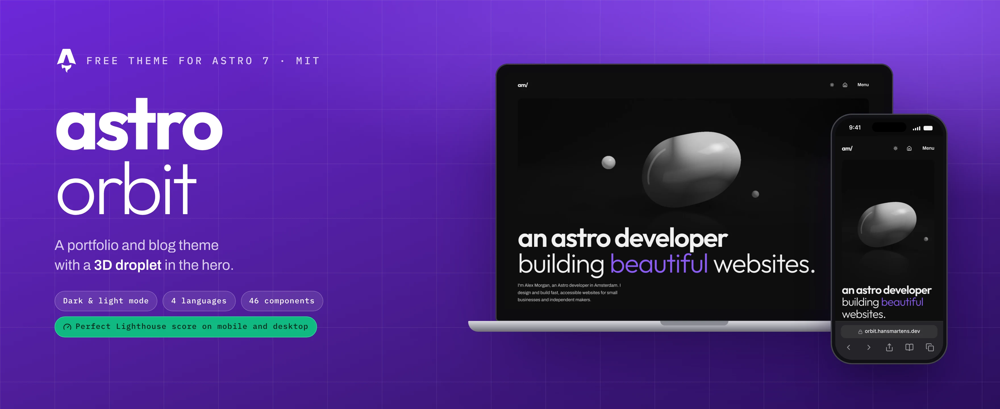

<p align="center">
  
</p>

<p align="center">
  <strong>Astro Orbit</strong>: a portfolio and blog theme for Astro, with a 3D droplet in the hero.
</p>

<p align="center">
  <a href="https://astro.build"></a>
  <a href="https://tailwindcss.com"></a>
  <a href="https://threejs.org"></a>
  <a href="https://www.typescriptlang.org"></a>
  <a href="LICENSE"></a>
  <a href="https://github.com/hansmartensdev/Astro-Orbit"></a>
  <a href="https://github.com/hansmartensdev/Astro-Orbit"></a>
</p>

<p align="center">
  <a href="https://orbit.hansmartens.dev"><strong>Live demo: orbit.hansmartens.dev</strong></a> · <a href="https://hansmartens.dev">Made by Hans Martens</a>
</p>

---

<details>
<summary></summary>

- [What it is](#what-it-is)
- [What's in it](#whats-in-it)
- [Lighthouse](#lighthouse)
- [Getting started](#getting-started)
- [Make it yours](#make-it-yours)
  - [The brand colour](#the-brand-colour)
  - [Dark mode only](#dark-mode-only)
  - [Your language](#your-language)
  - [The contact form](#the-contact-form)
  - [The newsletter](#the-newsletter)
  - [WhatsApp](#whatsapp)
- [Working with AI assistants](#working-with-ai-assistants)
- [Commands](#commands)
- [Deploying](#deploying)
- [Where things live](#where-things-live)
- [Credits and licence](#credits-and-licence)

</details>

## What it is

Astro Orbit is a free Astro theme for a personal website: a homepage, an About page, projects, a blog and a contact page.

The homepage hero has a 3D animation, made with three.js. A droplet comes out of the hero, follows a track down the homepage and opens into a card whose words light up one by one as you scroll. Then the card becomes a droplet again and lands as the first project card.

The other pages open with a full-screen hero: the project's picture, or the violet grid with an icon, and the page's facts in a strip at its foot.

The theme opens in dark mode, and visitors can switch to light mode with the button in the header. It comes in English, Spanish, French and Dutch.

## What's in it

- **Homepage:** the 3D hero, the droplet's track and its card, your latest six projects, your services in rows that open one at a time, quotes from clients, your latest four posts, and a sign-off with a contact button. The services are in `src/config/services.config.ts`; the quotes in `theme.config.ts`. `show: false` takes either off the homepage.
- **About page:** a hero with your photo or your mark, your facts, the years of your work (they count up as they come into view), a few words on how you work, recent projects and the tools you use.
- **Projects:** a page for each project, with a hero picture, sections of text beside pictures or videos, the stack, and the next project at the foot in one of two designs.
- **Blog:** posts in Markdown or MDX, with a table of contents, search (Pagefind), a category filter, related posts and a reading time. Each post gets a card picture with an icon and a short phrase, made at build time, so posts don't need images. Posts in the Performance category are emerald, the others the brand colour.
- **Contact:** a form that sends the message to your email through [Resend](https://resend.com).
- **Newsletter:** a signup under every post, with a confirmation email before an address is added.
- **Components page:** `/components` shows the 46 design-system components that come with the theme, live, with their code. `showcase = false` in `theme.config.ts` keeps it off your published site; you still see it in `pnpm dev`.
- **Share images:** every page gets its own picture for social media, made at build time.
- **For search engines and AI assistants:** a sitemap, an RSS feed, structured data and `llms.txt`.
- **Fonts:** Outfit, Archivo and IBM Plex Mono, served by the website itself.
- **Without a graphics chip:** the 3D scenes only run on a device with one. Other devices, and Lighthouse, see a still picture of the hero.

## Lighthouse

The demo's homepage scores 100 in all four Lighthouse categories on mobile.

<p align="center">
  <a href="https://pagespeed.web.dev/analysis/https-orbit-hansmartens-dev/9q2z7z86w4qmrl8969m0lc?form_factor=mobile">
    <picture>
      <source media="(prefers-color-scheme: dark)" srcset=".github/readme/lighthouse-dark.svg" />
      
    </picture>
  </a>
</p>

<p align="center"><a href="https://pagespeed.web.dev/analysis/https-orbit-hansmartens-dev/9q2z7z86w4qmrl8969m0lc?form_factor=mobile">See the PageSpeed report</a></p>

## Getting started

You need Node 22.23.4 or later and pnpm 10.

```bash
git clone https://github.com/hansmartensdev/Astro-Orbit.git my-site
cd my-site
pnpm install
pnpm dev
```

The site runs at http://localhost:4321.

## Make it yours

The demo is filled in for a fictive designer, Alex Morgan. Two files make it yours:

- **`src/config/site.config.ts`**: your name, your wordmark (`am/` in the demo, which unfolds into the name on hover), your email, location, WhatsApp link and social links.
- **`src/config/theme.config.ts`**: every text a visitor reads that is about you: the homepage, the About page, the contact page, the page intros, the sign-off, the newsletter and the footer line. Also the language, the brand colour, dark mode only and the components page (`showcase`).

Then:

1. **Your photo on the About page:** put it in `src/assets/about/` and import it at the top of `src/pages/about.astro` (the comment there shows how). Without one, the hero shows your mark.
2. **Your posts** go in `src/content/blog/<language>/`: `en/` for an English site. The post *Writing posts and adding projects* lists every field.
3. **Your projects** go in `src/content/work/`, with their pictures in `src/assets/work/`. A project without a picture stays out of the sitemap until it has one.
4. **The footer's links** are in `src/config/footer.config.ts`, the menu in `src/config/nav.config.ts`.
5. **Read the privacy page** (`src/i18n/privacy/<language>.astro`) and change what doesn't match your site. It names the Dutch data protection authority; name your own country's.

### The brand colour

Set `brandColor` in `theme.config.ts` to a hex code:

```ts
export const brandColor: string = '#2563eb';
```

The theme works out the lighter and darker shades itself, and checks each one's contrast in dark and light mode, stepping to a darker or lighter shade where text would be hard to read. `'default'` is the theme's violet. Pictures in `src/assets/` keep their own colours.

### Dark mode only

`darkOnly = true` in `theme.config.ts` removes the light/dark button: every visitor gets dark mode, and the site stores nothing in their browser.

### Your language

Set `language` in `theme.config.ts`: `'en'`, `'es'`, `'fr'` or `'nl'`. It sets the theme's own words (the menu, the labels, the buttons, the form's messages, the confirmation email and the privacy page), how dates are written, `<html lang>` and the RSS feed's language. Your own texts, in `theme.config.ts`, your posts and your projects, you write in that language yourself.

Posts are read from the folder for the language, such as `src/content/blog/nl/`. The build says so when that folder is empty and another one isn't.

For another language, such as German (`de`):

1. Copy `src/i18n/en.ts` to `src/i18n/de.ts` and translate the text between the quotes. `pnpm test` fails when a line is missing.
2. Copy `src/i18n/privacy/en.astro` to `src/i18n/privacy/de.astro` and translate it. Without it, the privacy page stays in English and the build says so.
3. Set `language = 'de'` in `theme.config.ts`.

### The contact form

The form sends messages through Resend. Set these in your host's environment:

| Variable | What it does |
|----------|--------------|
| `RESEND_API_KEY` | Your Resend API key. Without it, the form doesn't send in production. |
| `CONTACT_TO` | Where messages go. |
| `CONTACT_FROM` | The sender, on a domain you've verified in Resend. |

### The newsletter

The signup under every post uses the same Resend account: `RESEND_API_KEY`, and `CONTACT_FROM` as the sender of the confirmation email.

1. A visitor enters their email address under a post.
2. They get an email with a link to confirm. The link works for three days.
3. The link opens `/newsletter/`, and the Confirm button there adds the address to your contacts in Resend.

Nothing is stored before that click. Set `NEWSLETTER_SEGMENT_ID` to the Resend segment subscribers should go into, and send your newsletter as a broadcast to it, with an unsubscribe link. `newsletter.show: false` in `theme.config.ts` removes the signup.

### WhatsApp

Put a WhatsApp link (`https://wa.me/<your number>`) in `whatsapp` in `site.config.ts`, and a WhatsApp button appears in the sign-off, the footer and on the contact page, and the privacy page mentions it. Empty hides all of them.

## Working with AI assistants

`AGENTS.md` tells AI coding assistants (Claude Code, Codex, Cursor, Copilot) where everything is and which rules keep a change in line with the theme. `CLAUDE.md` points Claude Code to it. Ask your assistant to read it first.

## Commands

```bash
pnpm dev        # local dev server at http://localhost:4321
pnpm build      # static build, then the Pagefind search index
pnpm preview    # serve the build (search only works here, not in dev)
pnpm check      # Astro and TypeScript diagnostics
pnpm lint       # ESLint
pnpm test       # unit tests: languages, the newsletter link
pnpm validate   # lint, check and build
```

## Deploying

The theme builds for [Vercel](https://vercel.com). Every page is static, except the contact form's and the newsletter's endpoints, which run as Vercel functions. Set the environment variables above in the Vercel project.

## Where things live

```
src/
  config/theme.config.ts   your texts, language, brand colour, dark mode only, showcase
  config/site.config.ts    your name, mark, email, location and links
  content/blog/<language>/ blog posts
  content/work/            projects
  content/authors/         authors
  i18n/                    the theme's words per language, and the privacy page
  components/sections/     homepage and page sections
  components/site/         header, menu, footer, the heroes and the hero scene
  components/ui/           Velocity's design-system components (component-registry.json),
                           shown live at /components
  scripts/reel/            the droplet's animation down the homepage
  scripts/gpu.ts           decides whether the 3D scenes may run
  styles/themes/           colours and fonts
```

## Credits and licence

Astro Orbit is based on the **SWM26** website by [Southwell Media](https://github.com/southwellmedia), which is built on [Velocity](https://github.com/southwellmedia/velocity), the Astro starter by Southwell Media. Both are published under the MIT licence.

The changes and additions are by [Hans Martens](https://hansmartens.dev), built with [Claude Code](https://www.anthropic.com/claude-code).

MIT licence, see [LICENSE](LICENSE). The original code and design are © 2026 Southwell Media; the changes are © 2026 Hans Martens.
